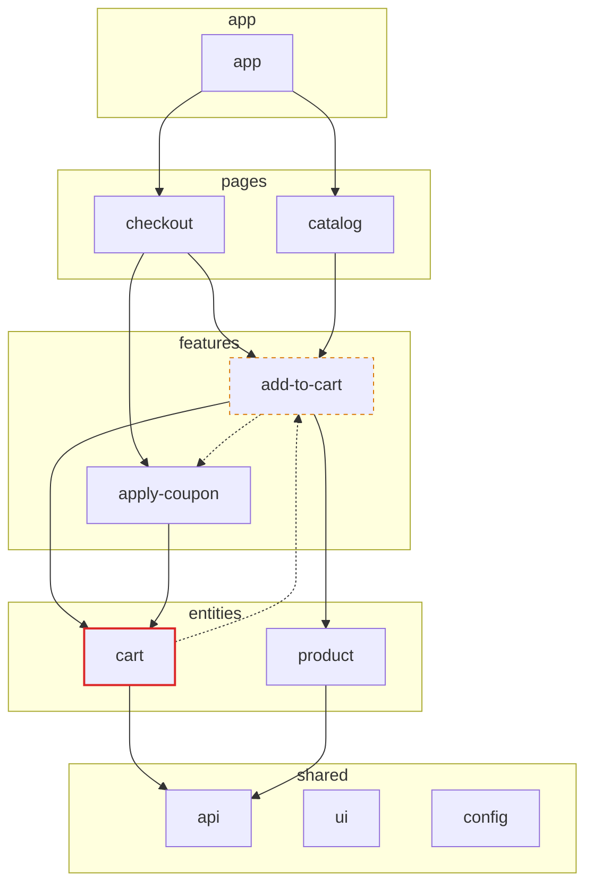
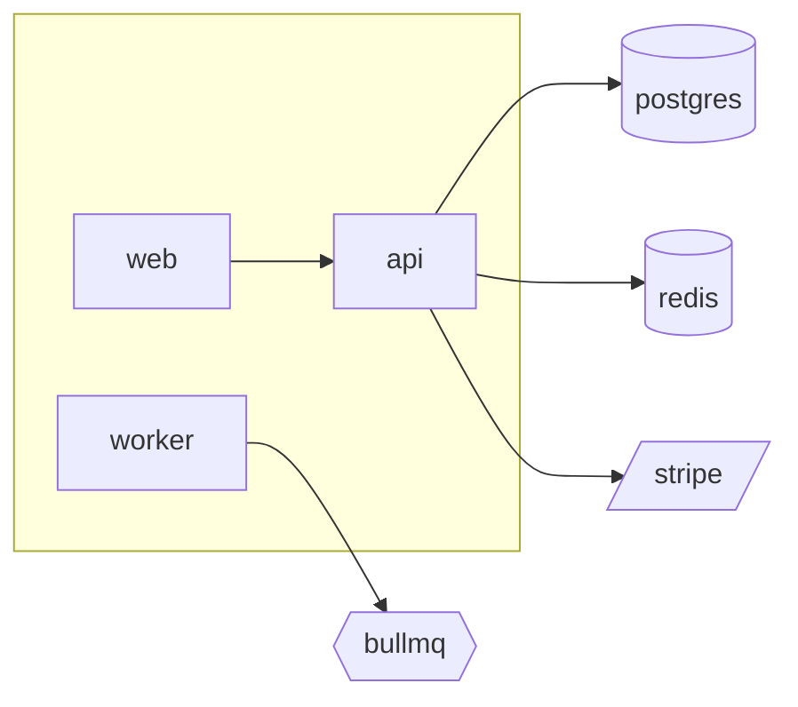

# Codebase map template

ALWAYS use this structure for `docs/codebase-map.md`. Section markers make updates idempotent and let the artifact canvas parse the file.

## Contents

- Full template
- View A: layers x slices
- View B: context
- View C: capability overlay
- Health table
- Mermaid limits
- Update algorithm

## Full template

````markdown
# Codebase Map

<!-- codebase-map:meta
generated: <git sha, short>
generated-at: <ISO date>
packages: [<package names or ".">]
stack: [<detected stacks>]
layers: [<ordered top to bottom>]
layout: <fsd | layered | domain-first | go-packages | python-packages | mixed>
extractor: <command or "grep">
feature-map: <docs/feature-map.md sha, or "none">
-->

Packages: <N>. Slices: <N>. Edges: <N>. External deps: <N>. Upward imports: <N>. Cross imports: <N>. Cycles: <N>.

## Layers

| Layer | Role | Slices | Files |
| --- | --- | --- | --- |
| app | composition root, providers, routing | 1 | 8 |
| pages | route-level screens | 6 | 41 |
| ... | | | |

<!-- view: layers -->
## View A — Layers x slices



Legend: solid arrow = import toward a lower layer. Dashed red = import toward a higher layer. Dashed amber = import between slices of the same layer.
<!-- /view -->

<!-- view: context -->
## View B — Context



| External | Kind | Used by | Package |
| --- | --- | --- | --- |
| postgres | database | infra/repositories | `pg` |
| stripe | http api | features/checkout | `stripe` |
<!-- /view -->

<!-- view: capabilities -->
## View C — Capability overlay

Present only when docs/feature-map.md exists.

| Capability | Slices | Layers touched |
| --- | --- | --- |
| Orders | pages/checkout, features/add-to-cart, entities/cart | pages, features, entities |
<!-- /view -->

## Health

| Slice | Layer | Files | Fan-in | Fan-out | Cycles | Upward | Cross | External | Tests |
| --- | --- | --- | --- | --- | --- | --- | --- | --- | --- |
| features/add-to-cart | features | 7 | 2 | 3 | 1 | 0 | 1 | 0 | yes |

## Unlayered

Slices whose path matched no layer.

| Slice | Files | Imported by |
| --- | --- | --- |

<!-- manual -->
<!-- /manual -->
````

## View A: layers x slices

- One `subgraph` per layer, ordered top to bottom as in the meta `layers:` list.
- One node per slice; label is the slice name without the layer prefix.
- Edges: slice-level imports. Chain targets with `&` to cut line count.
- Styling: `classDef bad` on sources of upward imports, `classDef warn` on sources of same-layer cross imports, `classDef cycle stroke:#7c3aed` on cycle members. Define the classes once, at the end.
- Above 40 nodes: one diagram per layer pair (`pages -> features`, `features -> entities`, ...) or per package, each under 40 nodes.

## View B: context

Internal deployable units as nodes inside one `subgraph`; external systems outside. Shapes: `[( )]` database, `{{ }}` queue or broker, `[/ /]` external HTTP API, `[ ]` internal unit. Derived from unresolved imports and well-known client packages (database drivers, HTTP SDKs, queue clients, cloud SDKs). The table lists the package name that proved each external.

## View C: capability overlay

Join `docs/feature-map.md` feature module lists with the slice keys of this map. Table only; no diagram. Skip the section when the feature map is absent, and record `feature-map: none` in the meta.

## Health table

Counts from the metrics section of the extraction reference. No thresholds, colors, or verdicts. Sort by layer order then slice name.

## Mermaid limits

- `flowchart` only. No `architecture-beta`, `C4*`, `treemap-beta`, `mindmap` in this file; the first three have unstable syntax, `mindmap` is unreadable, and the capability tree already lives in the feature map.
- Under 40 nodes and under 80 edges per diagram.
- Node IDs are short and stable (`F1`, `E2`); labels are real slice names.
- Edge labels only when the weight matters (`-->|12|`).

## Update algorithm

1. Parse existing meta, views, health, manual block.
2. Extract the graph as for a fresh run, reusing the `layers:` list from the meta.
3. Diff by slice key: added, removed, moved layer, changed edges.
4. Rewrite View A, View B, View C, Health, and Unlayered entirely (they are derived); keep the manual block byte for byte; keep the Layers table roles when the layer still exists.
5. Update the meta and the counts line.
6. Report added / removed / moved / edges changed counts to the user.
