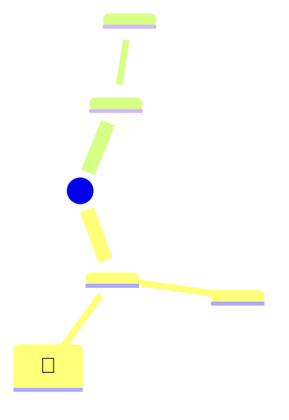
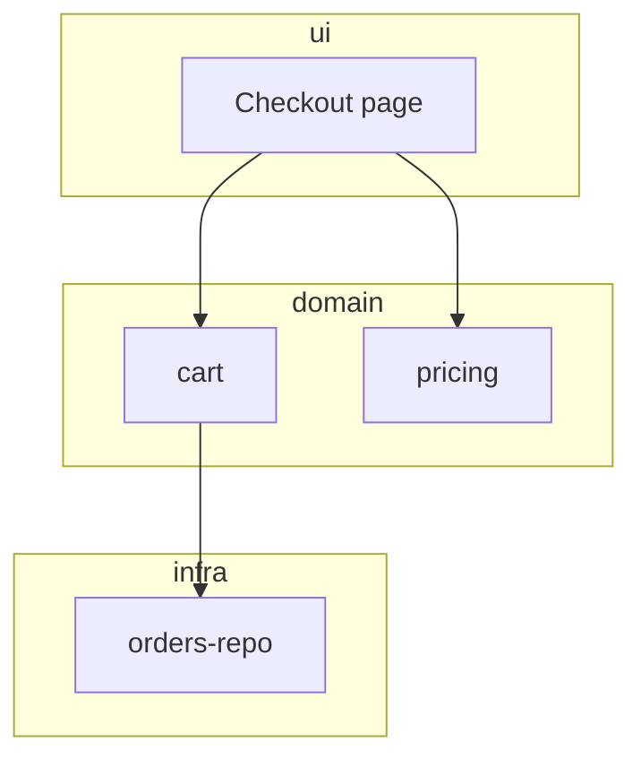

# Feature map template

ALWAYS use this exact structure for `docs/feature-map.md`. Section markers are what make updates idempotent.

## Contents

- Full template
- Meta comment
- Confidence tags
- Manual blocks
- Mermaid rules
- Splitting large maps
- Update algorithm

## Full template

````markdown
# Feature Map

<!-- feature-map:meta
generated: <git sha, short>
generated-at: <ISO date>
packages: [<package or app names, or "." for single package>]
stack: [<detected stacks>]
entrypoint-kinds: [<kinds actually found>]
layers: [<layer names used in this map>]
extractor: <tool used, or "grep">
-->

Capabilities: <N>. Features: <N>. Flags: <N>. Confidence: <N> EXTRACTED, <N> INFERRED, <N> AMBIGUOUS.

## Overview



## Capabilities

<!-- capability: <Capability A> -->
### <Capability A>

<One line: what this capability lets the user or consumer do.>

| Feature | Kind | Entrypoints | Layers | Flag | Tests | Conf |
| --- | --- | --- | --- | --- | --- | --- |
| <Feature 1> | http-route | `path/to/file.ts:12` | api, domain | - | `path/to/file.test.ts` | EXTRACTED |
| <Feature 2> | screen | `path/to/page.tsx` | ui, domain | `orders.checkout-v2` | - | INFERRED |

<!-- feature: <Feature 1> -->
#### <Feature 1>

- Purpose: <one line>
- Entry: `path/to/file.ts:12` (`handlerName`)
- Modules:
  - api: `path/to/routes/x.ts`
  - domain: `path/to/services/x.ts`, `path/to/models/x.ts`
  - infra: `path/to/repositories/x.ts`
- Depends on: <other features>, <external services, tables, topics>
- Used by: <features that call this one, or "-">
- Tests: `path/to/file.test.ts`
- Flag: - 
- Confidence: EXTRACTED

<!-- manual -->
<!-- /manual -->
<!-- /feature -->

<!-- feature: <Feature 2> -->
#### <Feature 2>
...
<!-- /feature -->
<!-- /capability -->

<!-- capability: <Capability B> -->
### <Capability B>
...
<!-- /capability -->

## Flags

<table from references/flag-detection.md, or "No feature flag mechanism detected.">

## Unattributed

Entrypoints found but not assigned to a capability. Resolve in the next run.

| Entrypoint | Kind | Location | Why |
| --- | --- | --- | --- |
````

## Meta comment

Machine-readable header. `generated` is compared with `git rev-parse --short HEAD` on the next run to decide whether an update is needed. `layers` and `entrypoint-kinds` are reused as-is on update so vocabulary stays stable.

## Confidence tags

| Tag | Use when |
| --- | --- |
| `EXTRACTED` | entrypoint and every listed module were read in the code, and attribution follows an explicit import, route, or registration |
| `INFERRED` | attribution rests on naming, folder position, or a followed include chain without an explicit reference |
| `AMBIGUOUS` | the feature could belong to two capabilities, or an entrypoint has no identifiable owner |

Only `AMBIGUOUS` items may be turned into questions for the user. `INFERRED` items are reported, not asked about, unless the user asks for a confirmation round.

## Manual blocks

Content between `<!-- manual -->` and `<!-- /manual -->` is owned by humans. On update: copy it byte for byte into the regenerated feature block. If the feature was deleted from the code, move its manual block under `## Unattributed` with a note so nothing written by hand is lost.

## Mermaid rules

- Overview: `mindmap`, max 40 nodes. Above that, show only capabilities in the overview and add one `flowchart` per capability inside its section.
- Per-capability diagram (optional, only when a capability has more than 3 features or the user asks):



  One `subgraph` per layer, one node per module, arrows follow imports. Use the layer names from the meta comment.
- Flagged features get the `🚩` suffix in diagrams. No other emoji.
- Node labels are feature or module names that exist in the repository.
- No `architecture-beta`, `C4*`, or `treemap-beta` in the map file: their syntax is not stable across renderers.

## Splitting large maps

When the file would exceed 500 lines, keep `docs/feature-map.md` as the index (meta, overview, capability list with one line each, Flags, Unattributed) and write one file per capability at `docs/feature-map/<capability-slug>.md` using the capability block above. Link each from the index.

## Update algorithm

1. Parse existing file: meta, every `<!-- capability -->` and `<!-- feature -->` block, every manual block.
2. Harvest from code as for a fresh run.
3. Diff by feature name within capability:
   - new entrypoint -> new feature block, appended to its capability table and details
   - entrypoint gone -> remove its block; keep its manual block under Unattributed
   - changed modules, tests, flag -> rewrite that feature block only
   - unchanged -> leave the block untouched, including its ordering
4. Rewrite Flags and Unattributed sections entirely.
5. Update the meta comment and the counts line.
6. Report `added / removed / changed / unchanged` counts to the user.

Never rename an existing capability on update without asking; renaming breaks links and manual blocks.
