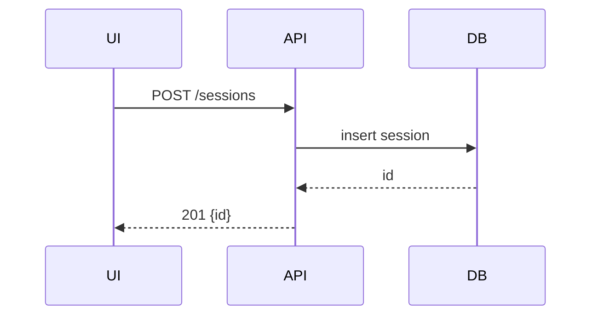

# Show Me

Replace paragraphs with the one view that makes the point. Prose stays to one or two lines per view.

---

## Rules

1. **Ground first.** Read the files involved before drawing. Every name in the view (file, function, component, state, participant) exists in the repo or in the user's message. Never invent a plausible name. Unknown -> `?` with a one-line note.
2. **Smallest view wins.** Pick one view from the table. Add a second only when it answers a different question. Never more than three.
3. **Cut to the question.** Keep only the nodes needed to answer what was asked. Target under 25 lines per view. Over budget -> collapse siblings into `...` and offer to zoom.
4. **Annotate ownership.** Add file paths or module names in parentheses or trailing `#` comments when the user asks where something lives or who owns it.
5. **One term per concept.** Same label for the same thing across every view in the answer.
6. **Offer the next zoom.** End with one line: what the user can ask to zoom in, zoom out, or switch view.

---

## Picking the view

| Question shape                                      | View             | Fence     |
| --------------------------------------------------- | ---------------- | --------- |
| How does this logic / algorithm / state machine work | Pseudocode       | `text`    |
| What calls what at runtime, in what order            | Call tree        | `text`    |
| How is the UI composed, where does state live        | Component tree   | `tsx`     |
| Who owns what, what is each folder for               | File tree        | `text`    |
| How do parts interact over time                      | Mermaid sequence | `mermaid` |
| What are the states and transitions                  | Mermaid state    | `mermaid` |
| What depends on what / data flow                     | Mermaid flowchart | `mermaid` |
| How does the schema relate                           | Mermaid ER       | `mermaid` |
| What changes, shape already known                    | Diff sketch      | `diff`    |
| Target shape is mostly new or must be copyable       | Full block       | language  |
| Visual layout, side-by-side comparison, too dense for Mermaid | HTML artifact | file |

Default when unsure: pseudocode for behavior, call tree for flow, file tree for structure.

---

## View shapes

Pseudocode: indentation is the structure, no syntax noise.

```text
on(save)
  if content unchanged
    return cached
  write content
  invalidate cache
```

Call tree: one call per line, children indented, no arguments.

```text
submitForm
  createSession
    persistPrompt
    launchAgent
  navigateToSession
```

Component tree: JSX-like, hooks inline, owner path when it matters.

```tsx
<SessionPage>                 (src/routes/session.tsx)
  useSessionEvents()
  <SessionToolbar>
    <RunSkillButton>          (packages/ui)
```

File tree: shallow, one responsibility comment per entry.

```text
src/
├── commands/     # parses user actions
├── sessions/     # owns session state
└── transport/    # talks to the API
```

Diff sketch: reuse whichever shape above fits, mark only what moves.

```diff
 submitForm
   createSession
+    expandSkillMention
     launchAgent
-  navigateToSession
+  navigateToSession
+    subscribeToEvents
```

Mermaid: pick the diagram type from the table. Quote labels containing `(`, `)`, `:` or `/`. Max 8 participants or 12 nodes; above that, group and offer a zoom.



---

## HTML artifact

Use only when text and Mermaid cannot carry the point: layouts, visual comparisons, infographics, short slide decks.

- Single file, inline CSS and JS, no network requests. Must render offline from `file://`.
- Mirror the product: real colors, type, spacing, and labels taken from the codebase. No lorem ipsum.
- Responsive down to 360px. Respect `prefers-color-scheme`.
- Write to `.cor/show-me/<slug>.html` when `.cor/` exists, otherwise `./show-me-<slug>.html`. Tell the user the path.
- Open it: `open <path>` on macOS, `xdg-open <path>` on Linux, `start <path>` on Windows. If opening fails, print the path only.

---

## Anti-patterns

- Paragraph then diagram that repeats the paragraph. Keep one.
- Nodes for every file touched. Keep the ones on the asked path.
- Mermaid when a 6-line call tree says the same.
- HTML artifact for a concept a flowchart handles.
- Invented function or file names to make the tree look complete.
- Full-sentence narration between views. One line each.
